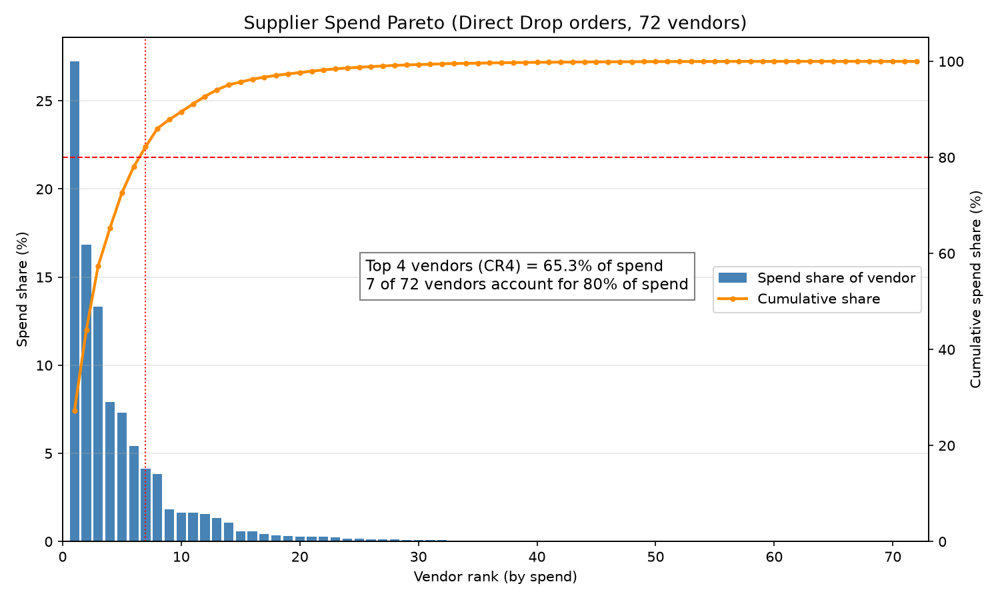
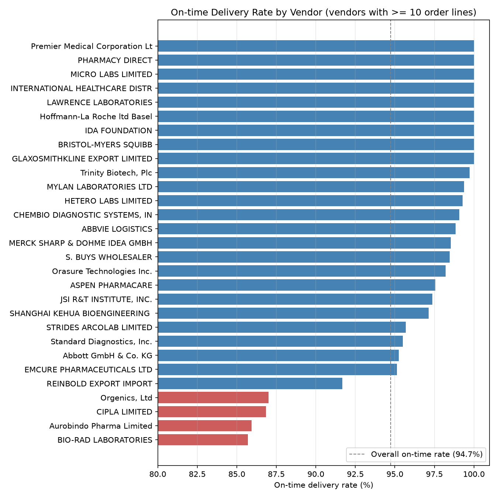
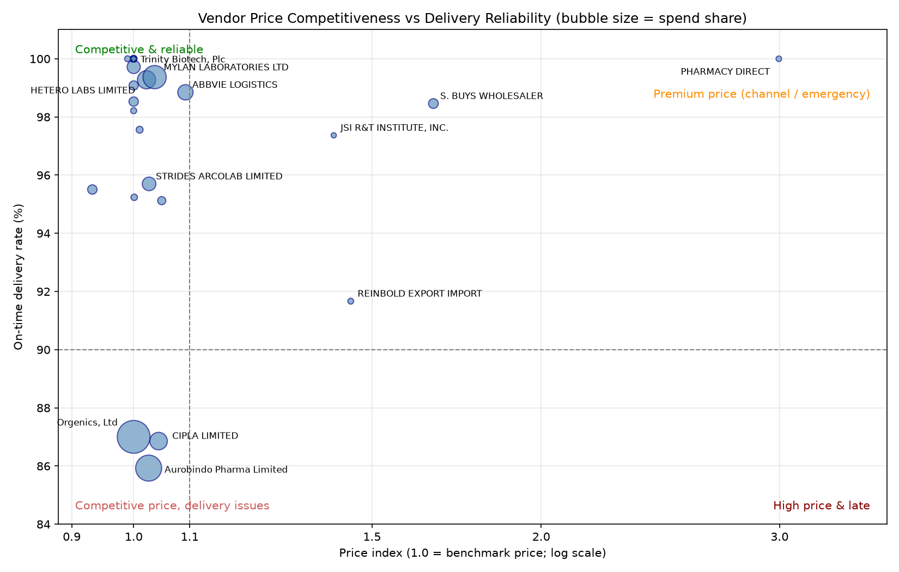

# Procurement Spend & Supplier Performance Analysis

> 采购支出与供应商绩效分析：用 Python 分析 1 万余条全球医药采购订单，完成支出集中度分析、跨供应商价格对标、交付绩效评估和供应商分级评分卡。

## Overview

This project analyses the **USAID Supply Chain Shipment Pricing Dataset** (10,324 purchase order lines, 2006–2015, ~USD 1.63 billion in spend) from a procurement team's point of view. It answers four questions:

1. **Where does the money go?** Spend concentration by supplier
2. **Are we paying different prices for the same item?** Price benchmarking across suppliers
3. **Which suppliers deliver late?** On-time delivery performance
4. **How should suppliers be managed?** A weighted supplier scorecard and segmentation

The supplier-level analysis focuses on **direct-from-vendor orders** (4,911 lines, 72 suppliers, USD 542M). Orders shipped from regional distribution centres are recorded under a single vendor name ("SCMS from RDC") and do not identify the original manufacturer, so they are excluded from supplier comparisons.

## Key Findings

| Area | Finding |
|---|---|
| Spend concentration | The top 4 suppliers account for **65.3%** of direct spend; 7 suppliers reach 80%; the bottom 50 suppliers account for only 1.8%. |
| Price benchmarking | Comparing prices for the same item in the same year, **322 negotiation opportunities** were identified. Conservative estimated saving: **≈ USD 13.2M** (3.5% of comparable spend); theoretical upper bound: USD 26.1M. |
| Channel pricing | Distributors and wholesalers have a price index of 1.41–3.00 (i.e. 41%–200% above the benchmark price), while manufacturers sit between 0.93 and 1.09. |
| Delivery | Direct on-time delivery rate is 94.7%. Three scorecard suppliers fall below the 90% red line: Orgenics, Aurobindo and Cipla. |
| Data quality flag | **86.6%** of orders arrived exactly on the scheduled date, which suggests scheduled dates may have been updated after delivery. The on-time rate is therefore likely overstated. |
| Segmentation | 25 suppliers (97.2% of direct spend) were segmented into Strategic / Preferred / Approved / Watch tiers (4 / 11 / 6 / 4 suppliers, holding 65.3% / 25.8% / 3.8% / 2.3% of spend). |

## Charts

**Supplier spend Pareto curve**



**On-time delivery ranking (suppliers with ≥ 10 order lines)**



**Price index vs on-time rate**



## Methodology

### 1. Data cleaning
- Read the file with `latin-1` encoding.
- The `Freight Cost (USD)` field mixes numbers and text notes (e.g. "Freight Included in Commodity Cost", "Invoiced Separately"). It was split into a numeric amount and a freight type.
- Parsed two different date formats explicitly.
- Removed 17 zero-value order lines. Checked for duplicates and negative values (none found).

### 2. Spend analysis
- Ranked suppliers by spend, calculated cumulative share (Pareto) and the CR4 concentration ratio.

### 3. Price benchmarking
- Prices are compared only **within the same item description and the same year**, so different products and year-on-year price changes are not mixed up.
- Excluded 5 abnormally low price lines (below 10% of the group median). 67 high-price lines were reviewed and kept, as they reflect real wholesale-channel prices.
- Potential saving = (supplier's average price − benchmark price) × quantity, floored at zero.
- **Conservative estimate:** the benchmark supplier must hold at least 10% of the quantity in that item-year group, so a one-off small cheap order cannot set the benchmark.

### 4. Delivery performance
- On-time = delivered on or before the scheduled date.
- Supplier ranking includes only suppliers with at least 10 order lines, to avoid unreliable rates from tiny samples.

### 5. Supplier scorecard

| Dimension | Weight | Scoring (clipped to 0–1) |
|---|---|---|
| Price competitiveness | 35% | Price index 1.0 → 1 point, 1.5 → 0 points |
| Strategic importance (spend share) | 30% | 0% → 0 points, ≥ 10% → 1 point |
| On-time delivery | 20% | 80% → 0 points, 100% → 1 point |
| Freight cost ratio | 15% | 0% → 1 point, ≥ 20% → 0 points (missing → 0.5) |

- Tiers: **Strategic** ≥ 0.75, **Preferred** 0.65–0.75, **Approved** 0.50–0.65, **Watch** < 0.50.
- Delivery red line: any supplier with an on-time rate below 90% is flagged, regardless of tier.

## Limitations

- Price comparison does not adjust for freight or INCO terms, so prices that include freight may look more expensive.
- On-time rate is measured per order line, not per shipment, so large shipments with many lines carry more weight.
- Suppliers without comparable price data drop out of the scorecard. For example, BIO-RAD (on-time rate 85.7%, the lowest among ranked suppliers) is not scored.
- Weights and scoring anchors are judgement calls, not derived from data.
- This is a descriptive analysis. It shows patterns and correlations, not causes.
- Savings are estimates based on historical prices, not realised savings. Capacity, product registration and contract terms were not considered.

## Repository Structure

```
procurement-spend-analysis/
├── procurement_analysis.ipynb   # Full analysis with code and outputs
├── *.png                        # Charts used in this README
└── README.md
```

## How to Reproduce

1. Download the dataset from [Kaggle](https://www.kaggle.com/datasets/apoorvwatsky/supply-chain-shipment-pricing-data) and save it as `data/supply_chain_shipment.csv`.
2. Create an empty `images/` folder next to the notebook (the notebook saves charts there).
3. Install the required packages:
```
   pip install pandas matplotlib jupyter
```
4. Open `procurement_analysis.ipynb` and run all cells. The negotiation opportunity list and supplier scorecard will be exported to `data/`.

## Data & License

- **Source:** USAID Supply Chain Management System (SCMS), *Supply Chain Shipment Pricing Data* (SCMS Delivery History Dataset).
- **License:** [CC BY-ND 4.0](https://creativecommons.org/licenses/by-nd/4.0/).
- In line with the license's no-derivatives terms, neither the raw data nor the cleaned or derived CSV files are included in this repository. Please download the data from the original source.

## Tools

Python · pandas · matplotlib · Jupyter Notebook
